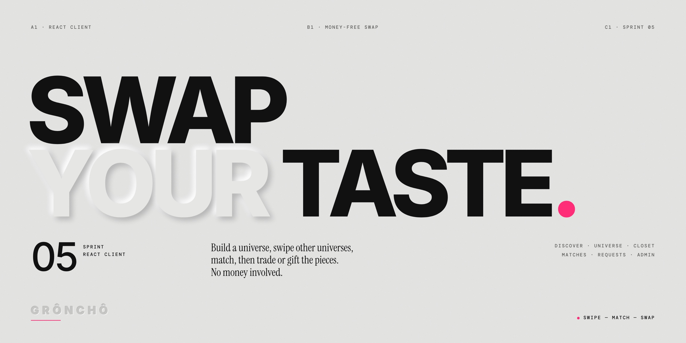
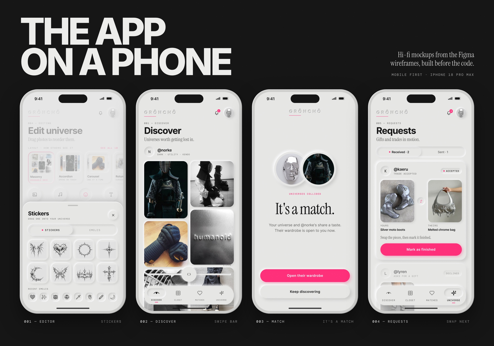
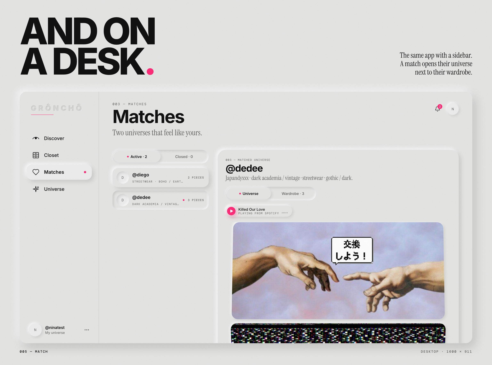
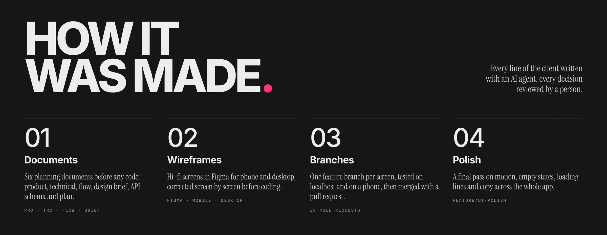

<p align="center">
  
</p>

# Grôncho Client

**Description**: React client for the Grôncho API, a money-free clothing swap. Build a universe, swipe other universes, match, then trade or gift the pieces. Built end to end with an AI agent.

<p align="center">
  
  
  
  
  
</p>

<table align="center">
  <tr>
    <td align="center"><h3><code>019</code></h3><sub><code>SCREENS</code></sub></td>
    <td align="center"><h3><code>049</code></h3><sub><code>ENDPOINTS USED</code></sub></td>
    <td align="center"><h3><code>066</code></h3><sub><code>TESTS</code></sub></td>
    <td align="center"><h3><code>018</code></h3><sub><code>PULL REQUESTS</code></sub></td>
    <td align="center"><h3><code>019</code></h3><sub><code>API PRS FOR THE FRONT</code></sub></td>
  </tr>
</table>

It is the Sprint 5 front-end delivery: the client for the [Grôncho API](https://github.com/DCdiegocortes/sprint05_api_Lv01_groncho), built with an AI model as the main author of the code. The app evolves the Sprint 4 Blade version into an interactive, mobile-first React client with a desktop layout, and this README records how the AI was used, what it produced and what had to be corrected.

## Index

| | | | |
|---|---|---|---|
| `001` [Requirements](#001--exercise-requirements) | `002` [Technologies](#002--technologies) | `003` [The app](#003--the-app) | `004` [Installation](#004--installation) |
| `005` [Demo](#005--demo) | `006` [AI model](#006--ai-model-and-why) | `007` [AI workflow](#007--how-the-ai-was-used) | `008` [Interactions](#008--significant-ai-interactions) |
| `009` [Code analysis](#009--analysis-of-the-ai-generated-code) | `010` [Front and API](#010--connecting-the-front-to-the-api) | `011` [Testing](#011--testing) | `012` [Structure](#012--project-structure) |
| `013` [Git workflow](#013--git-workflow) | `014` [Design](#014--design-decisions) | `015` [Reflection](#015--personal-reflection) | |

## 001 — Exercise requirements

| Requirement | How it is met |
|---|---|
| A front-end client that consumes the Sprint 5 API | React 19 client that uses 49 API endpoints: auth, profile, universes, items, swipes, matches, exchanges, rankings, notifications and admin moderation |
| Built with the help of an AI model | Every file of the client was written by Claude Code (Opus) following agent guides kept in the repo ([`AGENTS.md`](AGENTS.md), [`CLAUDE.md`](CLAUDE.md)) |
| Which model and why | See [006 — AI model](#006--ai-model-and-why) |
| Record of significant AI interactions | See [008 — Significant AI interactions](#008--significant-ai-interactions) |
| Analysis of the generated code | See [009 — Analysis](#009--analysis-of-the-ai-generated-code) |
| Front and back connection, challenges and solutions | See [010 — Connecting the front to the API](#010--connecting-the-front-to-the-api) |
| Personal reflection | See [015 — Reflection](#015--personal-reflection) |
| Code on GitHub with Gitflow | `main` · `develop` · one `feature/*` branch per screen, 18 pull requests merged into `develop` |

## 002 — Technologies

| Layer | Choice | Why |
|---|---|---|
| UI | **React 19** + JavaScript | Interactive screens (drag, swipe, live previews) that Blade could not give; no TypeScript to keep the code readable for a first React project |
| Build | **Vite 8** | Instant dev server, also reachable from a phone on the local network |
| Styles | **Tailwind CSS 4** | Design tokens in one `@theme` block in `src/index.css`, used as classes everywhere |
| Primitives | **shadcn/ui** on **Radix** | Accessible dialogs and sheets, restyled to the Grôncho tokens |
| Motion | **Motion** | Springs for the swipe bar, the dock tab bar and the layout magnification |
| Server state | **TanStack Query** + **Axios** | Caching, refetching and optimistic updates; one Axios client adds the token |
| Routing | **React Router** | Guards for guests, users without a universe and admins |
| Forms | **React Hook Form** + **Zod** | The same rules as the API FormRequests, checked before sending |
| Drag and drop | **dnd-kit** | Reordering photos and placing stickers on the universe |
| Icons | **Lucide** | Thin line icons that match the editorial look |
| Testing | **Vitest** + **Testing Library** | Tests run against a mocked API |
| Lint | **oxlint** | Fast lint run before every commit |

## 003 — The app

<p align="center">
  
</p>

<p align="center">
  
</p>

| Screen | What it does |
|---|---|
| **Landing · Log in · Sign up** | Register, then log in automatically (the API does not return a token on register) |
| **Create your universe** | Guided step cards: name, styles and a short description |
| **First photos** | Upload with progress, choose one of 10 layouts with a live preview |
| **My universe** | Editorial header, counters for pieces, matches and requests, the board with its soundtrack |
| **Universe editor** | Drag to reorder photos, change layout, add stickers, emojis and text, attach a Spotify song; it saves on its own |
| **Discover** | One universe at a time, a neumorphic swipe bar to like or nope, and the match moment |
| **Rankings** | Most wanted pieces and the people with the most swaps done, inside Discover |
| **Closet** | Pieces with filters for gift and trade, full photo view, add, edit and slide to delete |
| **Matches** | Each match opens their universe next to their wardrobe; request a piece or close the match |
| **Requests** | Received and sent; accept, reject, finish or cancel gifts and trades |
| **Notifications** | Bell with unread count, swipe to mark as read or delete, with undo |
| **Profile** | Avatar with a circular crop, handle, password change and slide to log out |
| **Admin** | Users list, user detail, delete users and moderate photos and pieces, with undo |

## 004 — Installation

Requirements: Node 20+, and the [Grôncho API](https://github.com/DCdiegocortes/sprint05_api_Lv01_groncho) running locally (see its README).

1. Clone the repository:
   ```bash
   git clone https://github.com/DCdiegocortes/sprint05_api_frontend_Lv01_groncho.git
   cd sprint05_api_frontend_Lv01_groncho
   ```
2. Install dependencies:
   ```bash
   npm install
   ```
3. Create the environment file and point it to the API:
   ```bash
   cp .env.example .env.local
   ```

   | Variable | Default | Notes |
   |---|---|---|
   | `VITE_API_URL` | `http://localhost:8000/api` | Base URL of the Grôncho API |

4. Start the API in another terminal (`php artisan serve`), then the client:
   ```bash
   npm run dev
   ```
   The app runs at `http://localhost:5173`.

**On a phone**: serve both on the local network and open the client from the phone.

```bash
# API, in its own folder
APP_URL=http://<your-ip>:8000 php artisan serve --host=0.0.0.0 --port=8000

# Client
VITE_API_URL=http://<your-ip>:8000/api npx vite --host 0.0.0.0
```

| Command | What it does |
|---|---|
| `npm run dev` | Dev server |
| `npm run test` | Runs the test suite once |
| `npm run lint` | oxlint |
| `npm run build` | Production build in `dist/` |

## 005 — Demo

After seeding the API (`php artisan migrate:fresh --seed`), every demo account uses the password **`password`**:

| Email | Role | Lands on |
|---|---|---|
| `ana@groncho.com`, `beto@groncho.com`, `carla@groncho.com`, `dani@groncho.com`, `eli@groncho.com` | user | Discover |
| `admin@groncho.com` | admin | Users (an admin does not need a universe) |

A short tour: log in as Ana, swipe in Discover, open a match and request a piece; log in as the owner of that piece and accept it in Requests; log in as the admin and moderate a universe.

> The demo accounts have a publicly known password. They are meant for local development and evaluation only.

## 006 — AI model and why

**Claude Code running Claude Opus**, used from the terminal and from the Claude desktop app.

| Need | Why this tool fits |
|---|---|
| Follow project rules | It reads [`AGENTS.md`](AGENTS.md) and [`CLAUDE.md`](CLAUDE.md) on every session, so tokens, folder rules and API facts are respected without repeating them |
| Design first | Through the Figma connection it built the hi-fi wireframes and read exact measurements from them before coding each screen |
| See the result | It runs the app in a built-in browser and in the iOS Simulator, measures elements and takes screenshots to check its own work |
| Both sides of the project | The same agent knew the Laravel API, so when a screen needed data the API did not return, it proposed the endpoint |
| Taste and motion | It loads skills on request: Impeccable for design reviews and Emil Kowalski's skills for animation, gestures and polish |

## 007 — How the AI was used

<p align="center">
  
</p>

**1. Documents before code.** Six planning documents were created from the API before any screen was coded:

| Doc | What it defines |
|---|---|
| `01` PRD | Product requirements: who the app is for and what it must do |
| `02` TRD | Technical requirements: stack, architecture and rules |
| `03` App flow | Every screen and how the user moves between them |
| `04` UI/UX brief | Visual identity, components and interactions |
| `05` Backend schema | What each endpoint returns, its limits, states and errors |
| `06` Implementation plan | The order of the branches and what each one delivers |

The backend schema is where the gaps were found between what the screens needed and what the API returned (see [010](#010--connecting-the-front-to-the-api)).

**2. Wireframes in Figma.** Every screen was designed in Figma first, for phone and for desktop, using the Sprint 4 identity as the starting point. I corrected each frame (copy, hierarchy, interactions) until it was right, and only then the screen was coded.

**3. One branch per screen.** For each feature the agent created the branch, built the screen against the wireframe, wrote its tests, and served the app so I could try it on the computer and on my phone. It only committed, opened the pull request and merged once I approved what I saw.

**4. Polish at the end.** The last branch went through the whole app: motion, empty states, loading lines, small text, links that react to hover and press, and a single back link style.

**Agent setup kept in the repo**

| File | What it does |
|---|---|
| [`AGENTS.md`](AGENTS.md) | Sources of truth, stack, commands, architecture rules, API facts the UI depends on and design rules |
| [`CLAUDE.md`](CLAUDE.md) | Claude Code specifics: read Figma before building a screen, check the running app in the browser, run tests and lint before calling a change done |
| `.claude/` | Project settings and the launch configuration for the dev server |

## 008 — Significant AI interactions

My prompts were written in Spanish; they are translated here and shortened. The result column is what the AI produced and what happened next.

| # | Prompt | Result |
|---|---|---|
| 01 | *"I'm giving you six documents: 01 PRD, 02 TRD, 03 App flow, 04 UI/UX brief, 05 Backend schema and 06 Implementation plan. Using them, build a plan that shows what is still needed to complete every screen."* | A plan screen by screen. The backend schema showed the gaps between what the screens needed and what the API returned; they became 19 pull requests in the API |
| 02 | *"I want the app to be interactive. Which technology do you recommend?"* | React + Vite + Tailwind, with Motion, TanStack Query and shadcn/ui, each one justified. I accepted it after asking how each library works |
| 03 | *"The swipe has to be interactive, not like/nope buttons. Maybe a neumorphic bar you drag, right for like and left for dislike."* | The swipe bar: a draggable knob with spring physics, icons that change with the direction, and keyboard arrows |
| 04 | *"Can you set up the environment with agent and Claude files so you can manage everything in the repository?"* | `AGENTS.md`, `CLAUDE.md` and the project settings, plus the base project with Vite, Tailwind, Vitest and oxlint |
| 05 | *"You always have to take every measurement from Figma, that is why I'm working on the wireframes first."* | It started reading exact sizes from each frame before coding, and measuring the rendered screen against them afterwards |
| 06 | *"An admin should also be able to delete photos of a universe and of the pieces, the main role of the admin is moderation."* | Moderation screens with multi-select (long press on the phone, shift click on desktop) and a 5 second undo before calling the API |
| 07 | *"For deleting a notification, make it interactive, like a swipe."* | Swipe left to mark as read, all the way to delete, with an undo toast |
| 08 | *"Use '‹ My universe' in a muted pink, reacting when the mouse is over it and when it is pressed."* | A shared back link used on every screen: 60% pink at rest, full pink and a small arrow nudge on hover, a press scale on click |
| 09 | *"How do we fix the cropping of the avatar?"* | A "Frame your photo" step: drag and zoom inside a circle, and only the circle is uploaded |

**Prompts that did not work at first**

| Prompt | What went wrong | How it was solved |
|---|---|---|
| *"Apply editorial design, it looks barely curated."* | The first wireframes mixed Spanish and English and looked generic | Everything was moved to English and rebuilt on the Sprint 4 identity: paper, ink, one pink, Inter, DM Mono and Instrument Serif |
| *"I don't like this landing. Here is my Sprint 4 project: take its identity, tokens and logo as the starting point, so the design evolves from there instead of going backwards."* | The first landing started from a blank style instead of the existing brand | With the Sprint 4 project as the reference, it carried the tokens and the logo over and built the new screens on them |
| Several rounds on the editor's Done button | Pills, corner labels, a pink comet line and a neumorphic card were all rejected | The button was removed: the editor saves on its own, shows *saving / saved* in the kicker, and you leave with the back link |
| *"Never use underlines to highlight."* | Hover states used underlines | A written rule in `AGENTS.md`: colour, opacity or depth only |

## 009 — Analysis of the AI-generated code

**What it does well**
- **Consistent structure**: screens never call Axios. A screen uses a hook, the hook uses `src/api`, and server state lives in TanStack Query with fixed query keys.
- **No magic values**: every API enum is mirrored in `src/lib/constants.js` (`OfferType`, `UniverseLayout`...), so components never compare raw strings.
- **Tokens, not hex**: colours, shadows, radii, type and motion come from the `@theme` block, so the whole app changes from one file.
- **Tests with each feature**: every screen came with tests against a mocked API, including error cases (409 on delete, 403 on the balance rule, 401 logout).
- **Accessible defaults**: Radix dialogs, labels on icon buttons, keyboard arrows on the swipe bar, reduced motion respected.

**What had to be corrected**

| Problem | Where | Fix |
|---|---|---|
| The avatar crop showed a blank image | `usePhotoPicker.jsx` | In development React runs effects twice; the effect cleanup revoked the image URL. The URL is now created when the file is picked and revoked when the panel closes |
| A finishing toast cleared a newer one | `Toast.jsx` | The toast now reports which toast finished, and only that one is cleared |
| Cards stayed magnified after a tap on touch screens | `LayoutPicker.jsx` | The magnification only follows a mouse (`pointerType === 'mouse'`) |
| A shell edit with `sed` broke a file | `guards.jsx` | The `&` in the replacement was read as "the whole match". Code changes are now made with an editor tool, never with scripts |
| A component defined inside another component | `boards/Photo.jsx` | Lint flagged it; the frame is now rendered with `createElement` |
| Pink used for small text, text under 10px | many screens | Small text became soft ink with a pink dot; every functional text is at least 10px |

**Characteristics I noticed**
- It writes working code fast, but its first visual proposals tend to be generic. Taste had to come from references, wireframes and corrections.
- It is literal: a rule it is told once (no underlines, no gradient fades, no arrows on buttons) is applied everywhere, but only after it is written down.
- When the API did not return something, it stopped and said so instead of faking data, because `AGENTS.md` asks for exactly that.

## 010 — Connecting the front to the API

The API from Sprint 5 was designed before any screen existed. Building the client showed what was missing, and each gap was solved in the API with its own tested pull request, labelled as a change needed by the front.

| Challenge | Solution |
|---|---|
| Universes came without photos or owner, so Discover could not show anything | `GET /universes/feed?search=` returns 10 universes with owner and photos, hiding your own and everyone you already swiped (API #29, #39) |
| After a swipe the client could not know a match had just happened | The swipe response now carries `matched` and `match_id` (API #25) |
| A match could not see the other person's wardrobe (`ItemPolicy` blocked it) | `GET /matches/{id}/items` for match participants (API #23) |
| The universe editor needed layout, photo order, decorations and a song | Layout with masonry as default, a reorder route, sticker / emoji / text decorations and a Spotify track link (API #31 to #34) |
| No avatar, handle or notifications | Avatar, handle and password change (API #35), in-app notifications (API #36) |
| Moderation one photo at a time | Bulk removal for admins (API #37) |
| The ranking exposed emails and roles | Hidden in the ranking response (API #38) |
| Register does not return a token | The client logs in right after registering |
| Requests without `Accept: application/json` answered 500 instead of 401 | One Axios client always sends `Accept` and the `Bearer` token; any 401 clears the session and goes to Log in |
| Images on a phone pointed to `localhost` | `APP_URL` set to the computer's IP when serving the API on the local network |
| The browser blocks reading API images inside a canvas (CORS) | The avatar crop works on the local file before uploading, never on the stored image |

## 011 — Testing

```bash
npm run test
```

66 tests across 16 files, written with Vitest and Testing Library against a mocked API, so they never touch real data.

| Area | Tests |
|---|---|
| Admin (list, filters, guard, delete, undo, moderation) | 9 |
| Universe (create, first photos, editor, my universe) | 11 |
| Discover, Rankings, Closet | 9 |
| Auth (log in, sign up, errors) | 6 |
| Profile (avatar crop and upload, password, log out) | 6 |
| Requests | 5 |
| Matches | 5 |
| Notifications | 4 |
| App shell | 4 |
| API client | 4 |
| UI primitives | 3 |

```bash
npm run lint
```

## 012 — Project structure

```
src/
├── api/                 # Axios client and one file per resource
├── app/
│   ├── router.jsx       # Routes and guards (guest, needs universe, admin)
│   ├── navigation.js    # Tabs for the dock and the sidebar
│   └── shell/           # Sidebar, dock tab bar, bell and avatar
├── components/
│   ├── ui/              # Button, Input, Chip, Dialog, Panel, Sheet, Segmented
│   ├── BackLink.jsx     # The pink back link used on every screen
│   ├── EmptyWall.jsx    # Animated empty states
│   ├── Loader.jsx       # Loading lines with a looping word fill
│   └── Toast.jsx  SlideToConfirm.jsx  Avatar.jsx  Logo.jsx
├── features/
│   ├── auth/            # Landing, log in, sign up
│   ├── universe/        # Create, first photos, my universe, boards, editor
│   ├── discover/        # Feed, swipe bar, match moment
│   ├── rankings/
│   ├── closet/          # Pieces, detail, photo viewer, add and edit
│   ├── matches/         # Matches, partner universe and wardrobe
│   ├── requests/        # Received and sent exchanges
│   ├── notifications/
│   ├── profile/         # Profile, avatar crop
│   └── admin/           # Users, detail, moderation
├── hooks/               # Media queries, element width, image ratios
├── lib/                 # constants.js (enums), schemas, session, query keys, loading lines
└── index.css            # Tailwind @theme: the Grôncho tokens

public/stickers/         # Sticker images for the universe editor
AGENTS.md  CLAUDE.md     # Guides for the AI agent
```

## 013 — Git workflow

The project follows **Gitflow**: `main` holds the scaffold, `develop` collects the delivered work, and each `feature/*` branch is one screen or capability, merged through a pull request with a merge commit.

| PR | Branch | What it adds |
|---|---|---|
| #1 | `feature/setup` | React, Vite, Tailwind, Vitest and the agent guides |
| #2 | `feature/design-tokens` | Grôncho tokens and the Button, Input and Chip primitives |
| #3 | `feature/api-client` | Axios client, token handling, endpoints for every resource, TanStack Query |
| #4 | `feature/auth` | Landing, log in and sign up |
| #5 | `feature/app-shell` | Dock tab bar, desktop sidebar, bell and avatar |
| #6 | `feature/universe-create` | Create your universe with step cards |
| #7 | `feature/universe-photos` | First photos with uploads and a live layout preview |
| #8 | `feature/universe` | My universe and the universe editor |
| #9 | `feature/discover` | Discover, the swipe bar and the match moment |
| #10 | `feature/universe-boards` | Interactive boards and the magnifying layout dock |
| #11 | `feature/closet` | Closet, piece detail, photo viewer, slide to delete |
| #12 | `feature/matches` | Matches with their universe and wardrobe, close a match |
| #13 | `feature/requests` | Accept, reject, finish and cancel gifts and trades |
| #14 | `feature/rankings` | Rankings inside Discover |
| #15 | `feature/notifications` | Bell dropdown, swipe actions and undo |
| #16 | `feature/profile` | Profile screen |
| #17 | `feature/admin` | Admin users and moderation |
| #18 | `feature/ui-polish` | Motion, empty states, loading lines, avatar crop, one back link |

## 014 — Design decisions

- **Evolve, not restart**: the Sprint 4 identity carries over. Paper `#E6E6E4`, ink `#111110` and one pink `#FF2D78`, used rarely: primary button, active tab, progress and unread dots.
- **Neumorphic paper**: raised for actions and things at rest, inset for what is selected or active.
- **Editorial type**: Inter for the interface, DM Mono for labels in uppercase, Instrument Serif for sublines. Every screen opens with a mono label (`002 — Closet`) and a bold headline.
- **Everything reacts**: buttons and text links answer hover and press (scale .97), lists and cards respond to drag and swipe, and destructive actions use a slide to confirm or an undo.
- **Rules written for the agent**: no underlines, no gradient fades, no arrows on buttons, no spinners. They live in `AGENTS.md` so every session follows them.
- **Mobile first, desktop too**: a dock tab bar on the phone, a sidebar with the same tabs on desktop, and dialogs instead of full pages where there is room.

## 015 — Personal reflection

Working with an AI as the main author changed what my job was. I wrote very little code by hand; most of my time went into deciding what the app should be, describing it precisely, and reviewing what came back. The planning documents and the Figma wireframes were the most useful part of the process: once a screen was designed and measured, the code that followed was right almost on the first try, while screens I described only with words needed many rounds of corrections.

I also learned that the AI does not bring taste on its own. Its first proposals were correct but generic, and the app only started to look like Grôncho when I gave it references, said clearly what I did not like, and wrote those rules down so they applied everywhere. Building the front also taught me about my own API: designing real screens showed data it was missing, and fixing it there, with tests, was better than working around it in the client.
